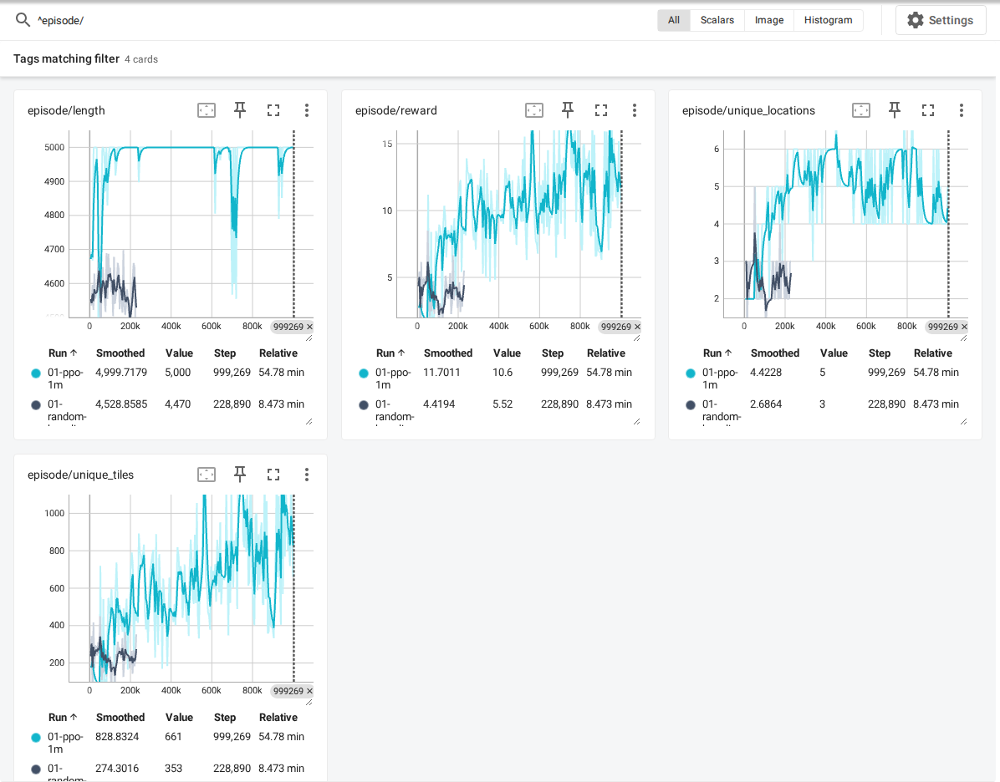
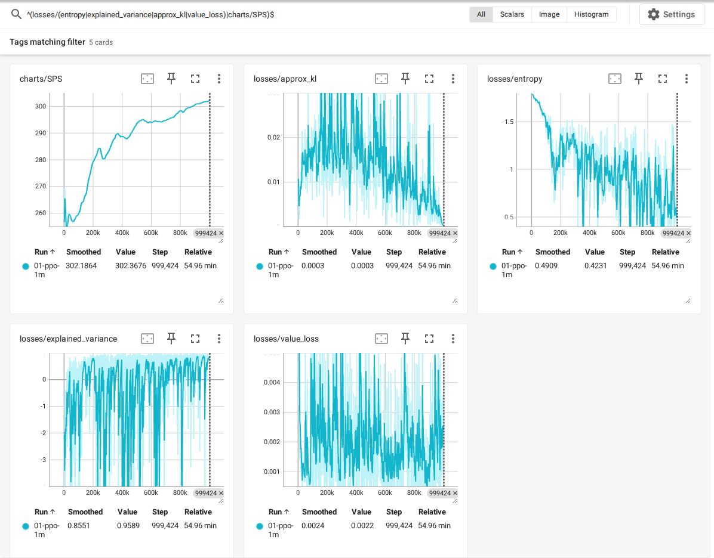
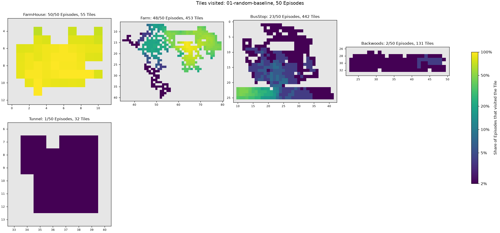
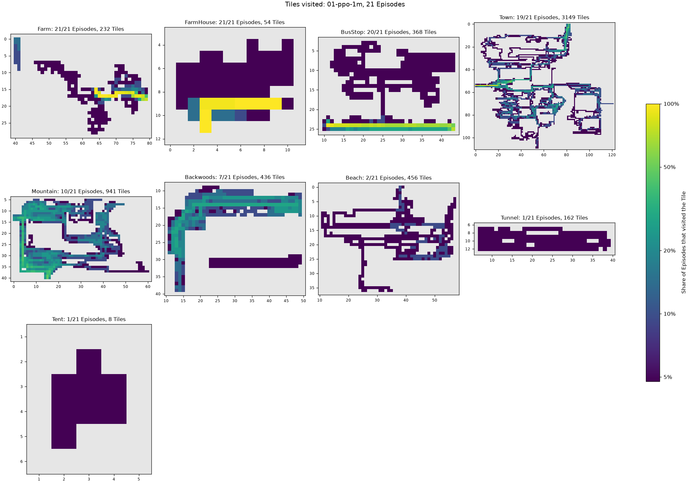

# Experiment 01: Exploration

Train an agent to explore SDV, rewarded for every new Tile and every new Location it reaches in an Episode. The spec is issue #1; the vocabulary is in `GLOSSARY.md`.

## Running

Start SDV through SMAPI with the Bridge installed (see `bridge/README.md`), then:

```bash
uv run python experiments/01-exploration/random_baseline.py   # --episodes 50 --seed 0 --run-name ...
uv run python experiments/01-exploration/train_ppo.py         # --config ppo.toml --run-name ...
uv run tensorboard --logdir runs
```

Each run writes to `runs/<run name>/` (not versioned):

- TensorBoard metrics, logged once per Episode against the total number of Steps so far. The tags are in `sdv_env/episode_log.py`, shared with PPO training: `episode/reward`, `episode/unique_tiles`, `episode/unique_locations` and `episode/length` (Steps).
- `episodes/episode_NNNNN.json`, one Episode log per Episode (PPO training keeps every 10th, `episode_log_every`): the Starting save, the action of every Step, the (Location, x, y) Tile at the start and after every Step, the Episode reward, unique Tiles and Locations, and its `ending`: `terminated` (2:00 AM or passing out) or `truncated` (the step limit). Read one with `sdv_env.episode_log.read_episode`.

## Random baseline

50 Episodes of uniformly random actions (`random_baseline.py --episodes 50 --seed 0`, run 2026-11-02), with the default Exploration reward (0.01 per new Tile, 1.0 per new Location) and step limit (5000):

| Metric | Mean ± std |
|---|---|
| Episode reward | 3.81 ± 1.44 |
| Unique Tiles | 234.2 ± 82.8 |
| Unique Locations | 2.48 ± 0.71 |
| Episode length (Steps) | 4578 ± 65 |

- Every Episode ended by termination, at 2:00 AM or passing out, before the step limit.
- Unique Tiles ranged from 55 to 451. The FarmHouse and the Farm account for most of them.
- 2 Episodes never left the FarmHouse, and 25 reached only the FarmHouse and the Farm. The Locations reached beyond those were the BusStop (23 Episodes), Backwoods (2) and Tunnel (1). No Episode reached Town.

## PPO

`train_ppo.py` is CleanRL's PPO in one file. It trains against one game instance. Settings live in `ppo.toml`: the four from the spec (learning rate 2.5e-4, γ 0.99, GAE λ 0.95, clip 0.2) plus CleanRL's other defaults. The rollout shape is the exception. CleanRL collects 4 envs × 128 Steps; with a single game, this collects 2048 Steps per update in 8 minibatches of 256. Episodes ended by the step limit are not bootstrapped, as in CleanRL.

The network has 3 conv layers over the View (4×15×15). An MLP takes a 16-wide Location embedding, the time and the one-hot facing. These join in a 256-wide shared body with separate policy and value heads. Runs write `config.json`, the losses (`losses/*`, `charts/SPS`) and a checkpoint every 25 updates (`checkpoints/agent_<Steps>.pt`) on top of the shared Episode metrics.

### First run: 1M Steps

`train_ppo.py --run-name 01-ppo-1m`, run 2026-11-02 with the default `ppo.toml`: 999,424 Steps (488 updates) and 201 Episodes in 55 minutes, ~300 Steps/s on an RTX 5060. The table compares the last 50 training Episodes (the last ~250k Steps, stochastic policy) with the 50 Random baseline Episodes:

| Metric | Random baseline | PPO, last 50 Episodes |
|---|---|---|
| Episode reward | 3.81 ± 1.44 | 11.88 ± 4.13 |
| Unique Tiles | 234.2 ± 82.8 | 801.2 ± 351.0 |
| Unique Locations | 2.48 ± 0.71 | 4.88 ± 1.04 |
| Episode length (Steps) | 4578 ± 65 | 4993 ± 36 |



- PPO clearly beats the Random baseline: about 3.4× the unique Tiles and twice the unique Locations. Every one of its last 50 Episodes reached at least 4 Locations, and the best reached 7. Unique Tiles ranged from 332 to 2236.
- Within ~100k Steps the agent learns to leave the FarmHouse. By ~300k it reliably goes Farm → BusStop → Town. The logged Episodes also reach the Mountain, Backwoods, Tunnel, Beach and Tent (Linus's). It enters no shop or house in Town; those doors need `interact`.
- The step limit now ends almost every Episode: 176 of 201, and 48 of the last 50. Unlike the Random baseline, the trained agent seldom reaches 2:00 AM within 5000 Steps. It walks into walls a lot. In the last logged Episode (episode 200), 4,066 of 4,885 moves were blocked, against 1,433 in episode 150 and 739 of 3,034 in a Random Episode. Blocked moves probably pass little game time. The step limit, not the day, now bounds an Episode. Once the agent has stopped finding new Tiles, nothing in the Exploration reward pushes it off a wall.
- Entropy fell from 1.79 (uniform over 6 actions) to ~0.5, and explained variance settled around 0.85–0.95 late in the run.



## Replays and heatmaps

### Replay

`replay.py` resets to an Episode log's Starting save and plays its actions back, by default with drawing on at normal speed (60 updates per second) for recording the screen with OBS or ffmpeg. It then compares the replayed trajectory of (Location, x, y) Tiles with the logged one and reports the first Step where they differ. `--fast` skips drawing, to check many Episodes quickly.

```bash
uv run python experiments/01-exploration/replay.py runs/01-ppo-1m/episodes/episode_00200.json   # 8 min for its 5000 Steps
uv run python experiments/01-exploration/replay.py --fast runs/01-ppo-1m/episodes/*.json
```

**Replays are deterministic, as far as we can tell.** Checked on 2026-11-02:

- **Rendered:** PPO Episode 200 (5000 Steps, FarmHouse → Farm → BusStop → Town → Beach) replayed with drawing on matched its log at every Step. It took 8 minutes, since blocked moves are short.
- **Fast:** the 71 logged Episodes (21 PPO, 50 Random baseline) replayed with `--fast`, and 70 matched. Random baseline Episode 17 diverged once, after 2349 Steps in the FarmHouse: an `up` that the log has blocked at (4, 5) went through to (4, 4). Six more replays of it matched, including two in the batch's order (Episode 16, then 17). The cause is unknown. One possibility is real keyboard or mouse input, which still reaches the game (see `bridge/README.md`), and the window was on screen at the time. So treat a replay as exact, but `replay.py` reports any divergence, and an Episode worth recording can be re-run.

Two things make this work. The Bridge runs every update with a fixed 1/60 s timestep and only while a Step runs, so the game never sees wall-clock time. SDV seeds its randomness from the save, which every reset reloads from the repo's Starting save. No seed or random state needs setting through the Bridge. A replay could still diverge if an Episode log came from a different Starting save, Bridge build or game version than the replay.

### Heatmap

`heatmap.py` draws the Tiles visited across a run's logged Episodes into `<run>/heatmap.png`, one panel per Location (the 12 that most Episodes reached), each Tile shaded on a log scale by the share of Episodes that visited it. The panels are plain grids around the visited Tiles, not the Location's map.

```bash
uv run python experiments/01-exploration/heatmap.py runs/01-ppo-1m   # --last 10 --output ...
```

The images below come from `--output experiments/01-exploration/images/heatmap-random.png` on `runs/01-random-baseline` and `--output experiments/01-exploration/images/heatmap-ppo.png` on `runs/01-ppo-1m`.

The Random baseline barely leaves the FarmHouse and the Farm, and wanders around both:



PPO's 21 logged Episodes (every 10th of the 1M-Step run) share one route out of the FarmHouse, across the top of the Farm, along the bottom of the BusStop and into Town, and spread out from there:


